# Journal du TP

## Étapes 1 et 2 : services Users et Orders

- `main.py` : API FastAPI, données en mémoire, 404 si ressource inconnue.
- `requirements.txt` : `fastapi`, `uvicorn`.
- `Dockerfile` : image `python:3.12-slim`, `pip --no-cache-dir`, utilisateur non-root `appuser`, pas de `.pyc`.

## Étape 3 : tests des services seuls

```bash
docker build -t eshop-users:local ./users
docker build -t eshop-orders:local ./orders
docker run --rm -p 8001:8000 eshop-users:local    # puis curl localhost:8001/users et /users/1
docker run --rm -p 8002:8000 eshop-orders:local   # puis curl localhost:8002/orders et /orders/user/1
```

Résultat : toutes les requêtes répondent 200 avec les données attendues.

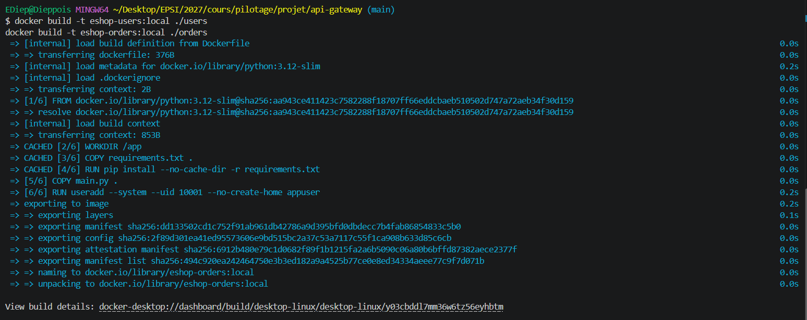
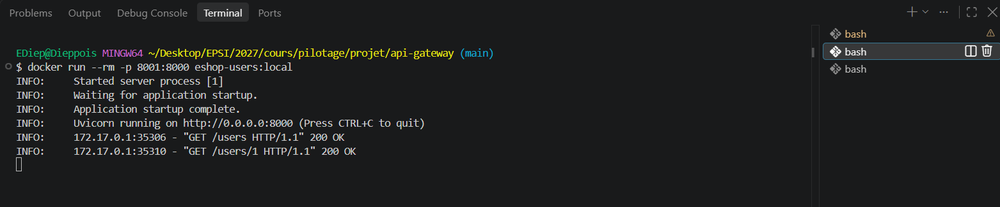
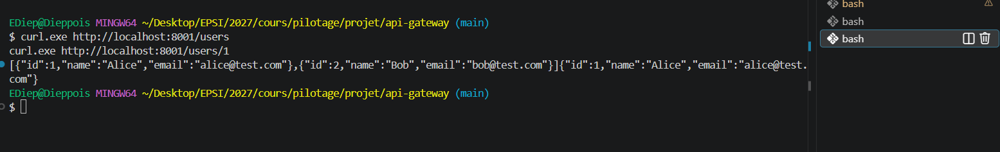
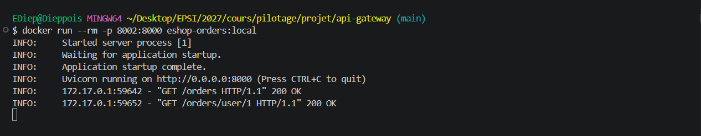
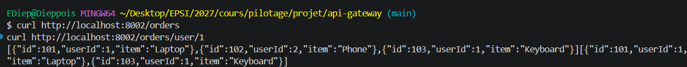

## Étape 4 : responsabilités de la Gateway

| Route | Rôle | Auth |
|---|---|---|
| `GET /users` | Proxy vers Users | Bearer |
| `GET /orders` | Proxy vers Orders | Bearer |
| `GET /profile/{id}` | Agrégation BFF user + commandes | Bearer |
| `GET /health` | État de la Gateway | Public |

Protections : jeton Bearer en variable d'environnement, timeout vers les services, erreurs internes masquées (502), backends sur réseau Docker privé sans port publié.

## Étape 5 : code de la Gateway

- `main.py` : auth Bearer comparée en temps constant (`secrets.compare_digest`), appels `httpx` avec timeout 5 s, erreurs backend converties en 502, `/profile/{id}` appelle Users et Orders en parallèle (`asyncio.gather`) puis filtre.
- `requirements.txt` : `fastapi`, `uvicorn`, `httpx`.
- `Dockerfile` : identique aux services (slim, non-root).

## Étape 6 : configuration et secrets

- `.env` : `GATEWAY_TOKEN` généré avec `openssl rand -hex 32`, jamais commité.
- `.gitignore` et `.dockerignore` : excluent `.env`, caches Python et `.venv`.

## Étape 7 : Docker Compose

- Seule la Gateway publie un port : `127.0.0.1:3000 -> 8000`.
- Réseau `backend` interne (Users, Orders, Gateway) et réseau `frontend` (Gateway seule, pour le port publié).
- Durcissement commun : `read_only`, `cap_drop: ALL`, `no-new-privileges`.
- Healthchecks sur `/health` (Python, pas de curl dans l'image slim). La Gateway attend que Users et Orders soient healthy.
- `GATEWAY_TOKEN` lu depuis `.env`, le démarrage échoue s'il manque.

## Étape 8 : démarrage de l'architecture

```bash
docker compose up --build -d
docker compose ps
docker compose logs gateway
```

Résultat : les 3 services passent `healthy`, seule la Gateway expose `127.0.0.1:3000->8000/tcp`.

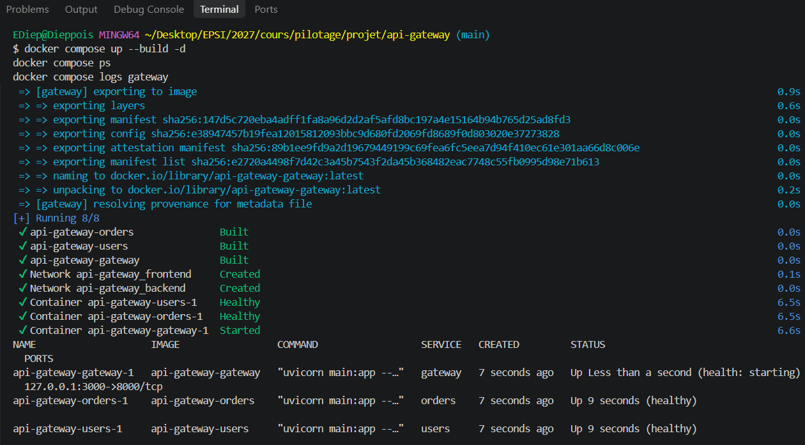
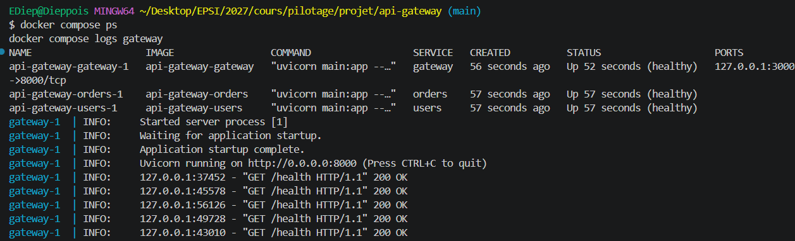

## Étape 9 : tests des endpoints

Jeton chargé avec `set -a; source .env; set +a`, puis `curl -i` sur `localhost:3000`.

| Requête | Attendu | Obtenu |
|---|---|---|
| `/users` sans jeton | 401 | 401 `Missing or invalid authentication token` |
| `/users` | 200 | 200 Alice, Bob |
| `/orders` | 200 | 200 commandes 101, 102, 103 |
| `/profile/1` | 200 | 200 Alice + commandes 101, 103 |
| `/profile/999` | 404 | 404 `User not found` |
| `/health` sans jeton | 200 | 200 `{"status":"ok"}` |

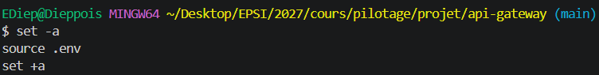
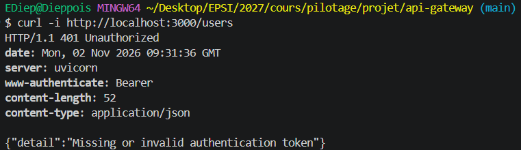
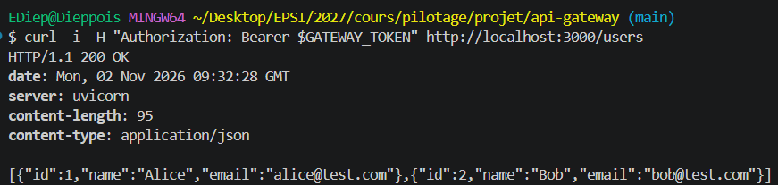
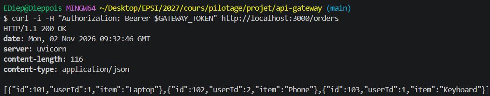
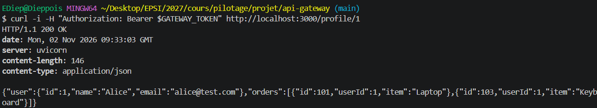
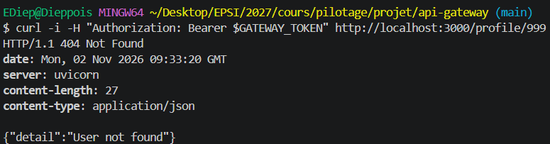
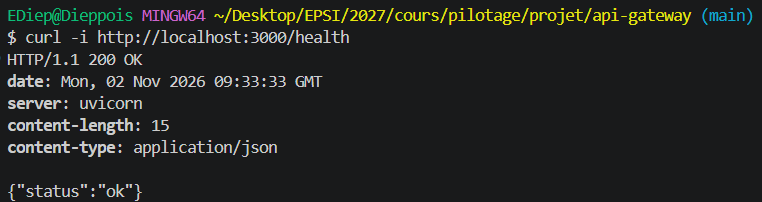

## Étape 10 : tests pytest

`tests/test_gateway.py` : 5 tests sur la Gateway isolée (appels backend simulés via `monkeypatch` de `fetch_json`).

- `/health` public, `/users` refusé sans jeton ou avec un mauvais jeton (401).
- `/profile/1` agrège Alice + commandes 101 et 103, `/profile/999` renvoie 404.

```bash
python -m pip install -r gateway/requirements.txt pytest
export GATEWAY_TOKEN=ci-test-token
python -m pytest -q
```

Résultat : `5 passed`.

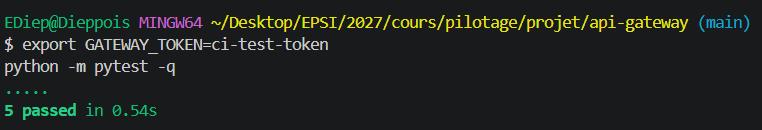

## Étape 11 : principe de la pipeline

Push sur GitLab -> stage `test` (pytest) -> stage `build` (3 images Docker) -> push dans le GitLab Container Registry, tag `$CI_COMMIT_SHA`. Le build ne s'exécute que si les tests passent.

## Étape 12 : pipeline CI/CD (adaptation GitHub)

Le projet est hébergé sur GitHub : `.gitlab-ci.yml` est remplacé par `.github/workflows/ci.yml` (GitHub Actions) et le GitLab Container Registry par GHCR (`ghcr.io`).

- Job `test` : Python 3.12, `pytest` avec un jeton fictif `ci-test-token`.
- Job `build` : `needs: test`, uniquement sur push. Construit et pousse `users`, `orders`, `gateway` vers `ghcr.io/<owner>/<repo>/<service>:<sha>`.
- Connexion au registry avec le `GITHUB_TOKEN` fourni automatiquement (équivalent des variables prédéfinies GitLab), permissions minimales (`packages: write` seulement sur `build`).
- Pas de Docker-in-Docker : les runners GitHub ont Docker nativement.

## Étape 13 : publication sur GitHub

Push sur GitHub, vérification de la pipeline dans l'onglet Actions et des 3 images dans Packages (GHCR).

Résultat : pipeline `CI #1` en succès (`test` 14 s, `build` 57 s), 3 packages `users`, `orders`, `gateway` publiés sur GHCR et liés au dépôt `Dieppois/api-gateway`, tagués avec le SHA complet du commit (`630aff2d795f...`).

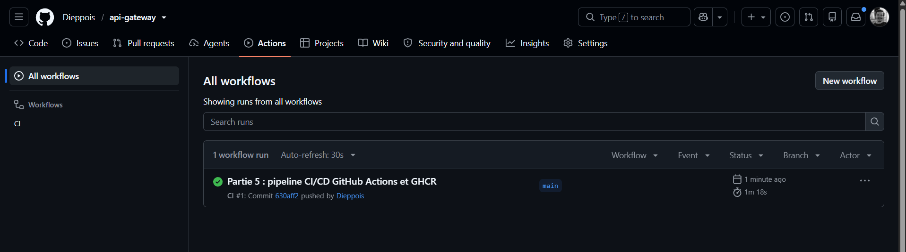
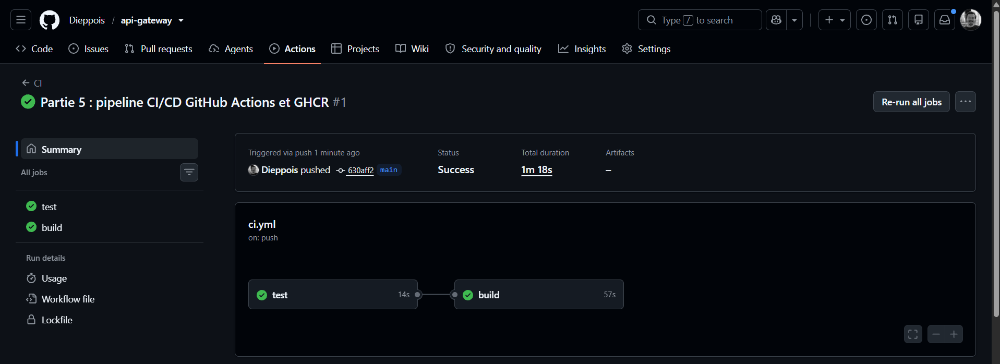
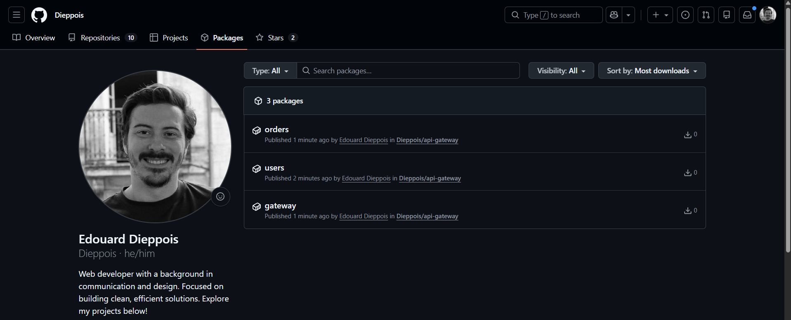
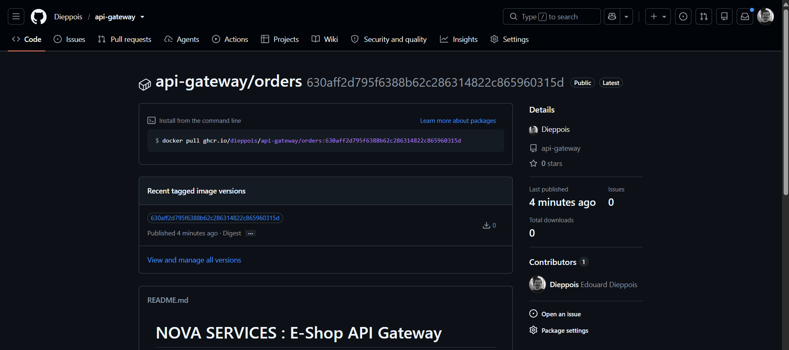

## Étape 17 : checklist de sécurité

- [x] `.env` exclu de Git (`.gitignore`, vérifié avec `git check-ignore`).
- [x] Jeton Bearer exigé sur `/users`, `/orders`, `/profile/{id}` (401 sans jeton).
- [x] Users et Orders ne publient aucun port sur l'hôte.
- [x] Communications internes sur le réseau Docker `backend` (`internal: true`).
- [x] Conteneurs non-root (`appuser`, UID 10001).
- [x] Timeout de 5 s sur les appels vers les microservices.
- [x] Erreurs backend masquées : le client reçoit seulement un 502 générique.
- [x] Connexion au registry via le `GITHUB_TOKEN` fourni par GitHub (équivalent des variables prédéfinies GitLab).
- [x] Images taguées avec le SHA du commit.
- [ ] Analyse des images et dépendances avant production : non réalisée (amélioration optionnelle).

## Étape 18 : questions de compréhension

**1. Avantages d'une API Gateway**
Point d'entrée unique : le client ne connaît pas l'organisation interne des services. La sécurité (authentification, timeouts, gestion des erreurs) est centralisée au même endroit. Elle peut agréger plusieurs services en une seule réponse (BFF), comme `/profile/{id}`, ce qui réduit le nombre de requêtes côté client.

**2. Inconvénients**
Point de défaillance unique si elle n'est pas redondée. Saut réseau supplémentaire, donc latence ajoutée. Risque de devenir trop complexe si on y concentre toute la logique. Elle demande supervision, gestion des secrets et mises à jour régulières.

**3. Gérer l'authentification et la sécurité**
Valider les jetons à la Gateway, idéalement des jetons courts émis par un fournisseur d'identité (OAuth 2.0/OIDC) plutôt qu'un secret statique. Appliquer des autorisations par ressource (authentification n'est pas autorisation), utiliser HTTPS, protéger et faire tourner les secrets, limiter le débit et restreindre l'accès réseau aux services internes. Les microservices doivent aussi contrôler les accès sensibles à leurs données : un réseau privé n'est pas une authentification.

**4. API Gateway vs reverse proxy NGINX**
Un reverse proxy route les requêtes et gère TLS, en-têtes et règles de trafic. Une API Gateway est orientée gestion d'API : authentification, quotas, gestion des clients, agrégation BFF. Les deux se recoupent, car NGINX peut être configuré pour remplir une partie de ces fonctions.
